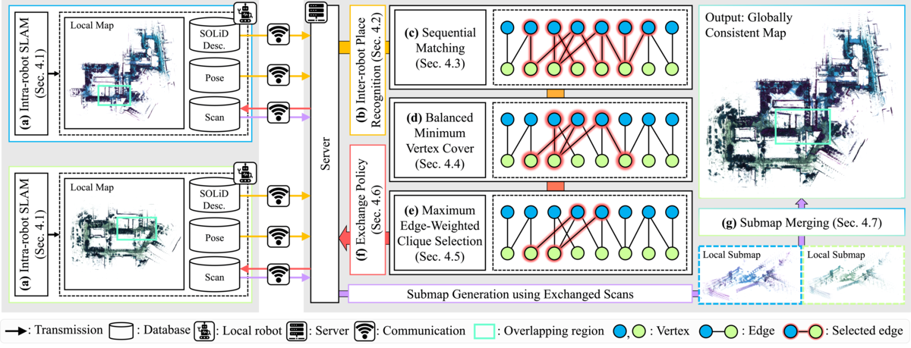
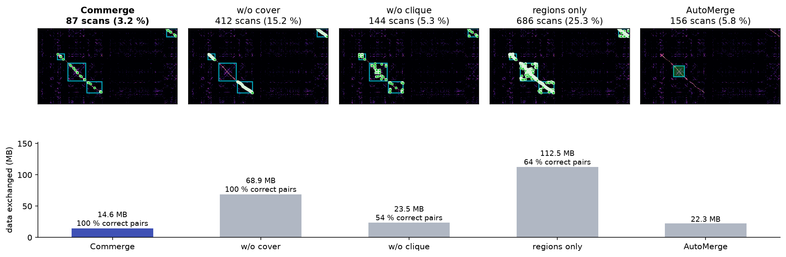

<div align="center">
  <picture>
    <source media="(prefers-color-scheme: dark)" srcset="assets/logo_dark.svg" />
    
  </picture>
  <br />
  <a href="https://github.com/sparolab/Commerge/tree/main/commerge"></a>
  <a href="#prerequisites"></a>
  <a href="#prerequisites"></a>
  <a href="https://github.com/sparolab/SOLiD"></a>
  <a href="#installation"></a>
  <a href="#installation"></a>
  <a href="LICENSE"></a>
  <a href="https://github.com/sparolab/Commerge/actions/workflows/ci.yml"></a>
  <br />
  <a href="https://sparolab.github.io/research/commerge/"></a>
  <a href="https://arxiv.org/abs/2606.25386"></a>
  <a href="https://sparolab.github.io/research/commerge/"></a>
  <a href="https://youtu.be/LV_8_jZbHV8"></a>
  <br />
  
  <br />
  
  <p>
    <strong>[IJRR 2026] Commerge: Communication-Efficient, Robust, and Fast LiDAR Map Merging Framework<br />
    for Multi-Robot Coordination in Resource-Constrained Scenarios</strong>
  </p>
</div>

______________________________________________________________________

> [!IMPORTANT]
> **[26.11.10]** Code released!<br />
> **[26.06.03]** Commerge accepted in IJRR 2026!

Robots that map on their own must exchange scans to merge their maps, and over a weak link that exchange is the bottleneck. Commerge picks the few scans that carry the overlap and sends only those:

- :link: **Sequential matching**: regions of the inter-robot affinity matrix where both robots saw the same places in sequence.
- :scales: **Balanced minimum vertex cover**: the fewest keyframes that still touch every candidate match, shared fairly between the robots.
- :gem: **Maximum edge-weighted clique**: among those, only the pairs that agree with each other geometrically.
- :package: **MB, not GB**: up to 99.98 % less data exchanged (7,000 MB → 1.3 MB on HeLiPR) with comparable alignment, also on a Jetson Nano.

<p align="center"></p>

<p align="center"></p>

______________________________________________________________________

## :package: Prerequisites

| | |
| --- | --- |
| Python | 3.9 or newer, with NumPy, SciPy and Matplotlib (installed with the package) |
| Optimisation solver | **[Gurobi](https://www.gurobi.com/academia/academic-program-and-licenses/)**, as in the paper: **free for academic use** (named academic licence, `pip install gurobipy`, then `grbgetkey <key>`). <br/> **No Gurobi licence?** Use **HiGHS**: it ships with SciPy, so there is nothing to install. It returns the same selection, only slower on the largest regions. |
| Keyframe sessions | one per robot, from [SOLiD](https://github.com/sparolab/SOLiD) (included as `thirdparty/SOLiD`): keyframe scans, poses and SOLiD descriptors |

The solver is picked with `--solver`: `auto` (default: Gurobi if it is installed and licensed, HiGHS otherwise), `gurobi` or `highs`.

## :hammer_and_wrench: Installation

```bash
git clone --recursive https://github.com/sparolab/Commerge.git
cd Commerge
pip install .                 # + ".[gurobi]" for gurobipy, ".[compare]" for the AutoMerge comparison
commerge --version
```

Ubuntu and macOS (Python only, no ROS needed for Commerge itself).

## :rocket: Run

**1. One session per robot** with SOLiD, with any odometry it supports ([FAST-LIO, KISS-ICP, GeoRIO, …](https://github.com/sparolab/SOLiD/tree/main/slam)) or without ROS:

```bash
cd thirdparty/SOLiD
roslaunch solid_ros run.launch odometry:=fast_lio save_dir:=$HOME/robot_a     # ROS 1, while the bag of robot A plays
ros2 launch solid_ros run.launch.py odometry:=kiss_icp save_dir:=$HOME/robot_b  # ROS 2
python slam/common/mac/solid_loops.py --kitti <sequence> --config slam/config/kitti.yaml --out $HOME/robot_a  # no ROS
```

**2. Select the scans to exchange and build the submaps:**

```bash
commerge $HOME/robot_a $HOME/robot_b --threshold 0.96 --min-area 2000 --out merged/ --plot
```

```
[commerge] kitti00_a: 1011 keyframes | kitti00_b: 1701 keyframes
[commerge] 4 region(s) (threshold 0.96, min area 2000) in 0.021 s; stages regions+cover+clique, solver gurobi
[commerge] region 2: A 250-381 x B 899-1027: 1077 candidate pairs -> cover 66+66 keyframes -> 24 pairs (14 A + 17 B scans), cover 0.18 s, clique 0.08 s
...
[commerge] selected 42 A + 45 B scans (3.2 % of 2712) in 4 region(s) -> merged/
```

| Output | |
| --- | --- |
| `selection.json` | regions, candidate pairs, cover size, selected keyframes of each robot, timings |
| `pairs.csv` | selected keyframe pairs (region, keyframe of A, keyframe of B, affinity) |
| `submap_A_<k>.pcd`, `submap_B_<k>.pcd` | the selected scans of each region, in each robot's frame: what gets exchanged and registered |
| `affinity.npy`, `selection.png` | the SOLiD affinity matrix; with `--plot`, the regions and selected pairs on it |

| Option | Default | |
| --- | --- | --- |
| `--threshold`, `--min-area` | required | affinity of a candidate pair, smallest region (cells of its bounding box) |
| `--consistency` | `3.0` | largest distance mismatch (m) between two consistent pairs |
| `--stages` | `regions,cover,clique` | any subset, for ablations: without `regions` the whole matrix is one region, without `cover` every candidate goes on, without `clique` every covered pair is kept |
| `--solver` | `auto` | `gurobi`, `highs` or `auto` |
| `--affinity` | SOLiD | any `(N_A, N_B)` `.npy` instead (another descriptor) |
| `--poses` | `auto` | `optimized` (loop-closed) or `odom` keyframe poses |
| `--min-range`, `--voxel` | `3.0`, `0` | submap: drop points near the sensor, optional voxel size |

From Python:

```python
from commerge import Session, cosine_affinity, select
A, B = Session.load("robot_a"), Session.load("robot_b")
sel = select(cosine_affinity(A.rsolid, B.rsolid), A.positions, B.positions, threshold=0.96, min_area=2000)
print(sel.keyframes_a, sel.keyframes_b)        # scans each robot sends
```

## :bar_chart: Compare

`commerge-compare` runs Commerge, its ablations and AutoMerge (our re-implementation of its SeqSLAM-based region selection, see [`commerge/baselines`](commerge/baselines)) on the same pair of sessions:

```bash
commerge-compare $HOME/robot_a $HOME/robot_b --threshold 0.96 --min-area 2000 --out compare/ [--gt-a gt_a.txt --gt-b gt_b.txt]
```

On KITTI 00 split into two robots (frames 0-1999 and 2000-4540, 2,712 keyframes, SOLiD affinity, threshold 0.96, min. area 2000; a pair is correct within 5 m in ground truth):

| Method | Scans sent (A + B) | Share of keyframes | Data | Correct pairs | Time |
| --- | --- | --- | --- | --- | --- |
| **Commerge** | **42 + 45** | **3.2 %** | **14.6 MB** | **100 %** | 0.8 s |
| w/o vertex cover | 182 + 230 | 15.2 % | 68.9 MB | 100 % | 82 s (solver time limit) |
| w/o clique | 69 + 75 | 5.3 % | 23.5 MB | 54 % | 0.4 s |
| sequential matching only | 317 + 369 | 25.3 % | 112.5 MB | 64 % | 0.01 s |
| AutoMerge (region selection) | 79 + 77 | 5.8 % | 22.3 MB | – | 18 s |

The vertex cover keeps the exchange small and the clique fast; the clique keeps only correct pairs.

<p align="center"></p>

______________________________________________________________________

## Citation

If you use Commerge in your research, please cite our [paper](https://arxiv.org/abs/2606.25386).

<details>
  <summary><strong>See bibtex</strong></summary>

```bibtex
@article{kim2026commerge,
  author  = {Kim, Hogyun and Choi, Jiwon and Kim, Juwon and Yang, Geonmo and Jeong, Seokhwan and Lim, Hyungtae and Cho, Younggun},
  title   = {Commerge: Communication-Efficient, Robust, and Fast LiDAR Map Merging Framework for Multi-Robot Coordination in Resource-Constrained Scenarios},
  journal = {International Journal of Robotics Research (IJRR)},
  year    = {2026}
}
```

</details>

## Contributing

Issues and pull requests are welcome.

<a href="https://github.com/sparolab/Commerge/graphs/contributors">
  
</a>

## Acknowledgements

Commerge uses [SOLiD](https://github.com/sparolab/SOLiD) for inter-robot place recognition. The comparison re-implements the region selection of [AutoMerge](https://github.com/MetaSLAM/AutoMerge_Server), which builds on [SeqSLAM](https://doi.org/10.1109/ICRA.2012.6224623). Related research: [KISS-Matcher](https://github.com/MIT-SPARK/KISS-Matcher), [SKiD-SLAM](https://github.com/sparolab/SKiD-SLAM).

## Special Thanks

We thank [Minwoo Jung](https://github.com/minwoo0611).
