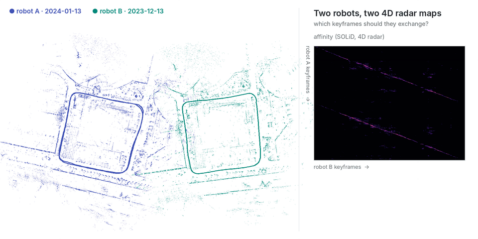

# 4D radar with SOLiD

<p align="center"></p>

Two days of the SNAIL-Radar **st** route: robot A on 2024-01-13 (422 keyframes), robot B on 2023-12-13 (221 keyframes). Each robot runs [SOLiD](https://github.com/sparolab/SOLiD)'s radar SLAM (`thirdparty/SOLiD`, ROS 2, GeoRIO odometry), which accumulates the 4D radar points of each keyframe into a submap and describes it with SOLiD, and saves a session. The demo replaces the keyframe poses by ground truth and moves robot B's into its own frame (**yaw 60°, (30, −20, 0) m**).

```bash
ros2 launch solid_ros run.launch.py odometry:=georio save_dir:=$HOME/st_20240113   # while 20240113/data1 plays
ros2 launch solid_ros run.launch.py odometry:=georio save_dir:=$HOME/st_20231213   # while 20231213/data1 plays
python tools/demo/4dradar/make_sessions.py --a $HOME/st_20240113 --gt-a <SNAIL gt>/20240113/data1/ref_tls_T_xt32.csv \
    --b $HOME/st_20231213 --gt-b <SNAIL gt>/20231213/data1/ref_tls_T_xt32.csv --out runs/4dradar
commerge runs/4dradar/robot_a runs/4dradar/robot_b --threshold 0.96 --min-area 30 --registration pairs --policy all \
    --out runs/4dradar/merged --gt-a runs/4dradar/robot_a/gt_poses.txt --gt-b runs/4dradar/robot_b/gt_poses.txt
```

```
[commerge] registered B to A from 7 selected pairs: RMS 0.96 m; vs ground truth: 1.29 m, 0.33 deg (B keyframes 0.57 m off on average)
[commerge] exchanged 6 A + 5 B keyframes (1.7 % of 643, 1.1 KB of poses) from region(s) [0, 1, 2] of 3
```

With robot B on 2023-12-08 instead: 0.37 m, 0.39°. The radar submaps are too sparse for KISS-Matcher (`--registration kiss` finds too few inliers), so the transform comes from the selected pairs (`--registration pairs`).
