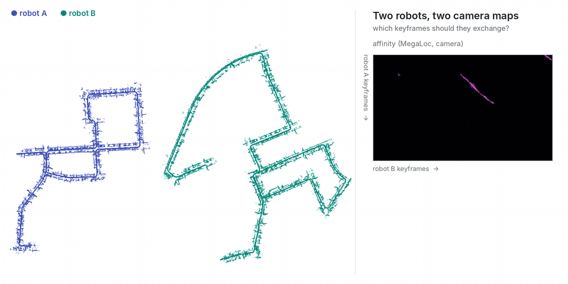

# Camera with MegaLoc

<p align="center"></p>

The main demo's two robots (KITTI 00: robot A frames 0–1999, robot B 2000–4540, the same keyframes), described by the left color camera instead of SOLiD. Keyframe poses: KITTI ground truth in the LiDAR frame, robot B's moved into its own frame (**yaw 60°, (30, −20, 0) m**). The descriptor is [MegaLoc](https://github.com/gmberton/MegaLoc) (`torch.hub`, 8448-D), compared by cosine similarity.

```bash
python tools/demo/camera/make_sessions.py --images <KITTI color>/sequences/00/image_2 --poses <KITTI>/poses/00.txt \
    --a robot_a --b robot_b --out runs/camera            # robot_a / robot_b: the SOLiD sessions of AGENTS.md step 4
python tools/demo/camera/points.py --seq <KITTI color>/sequences/00 --sessions runs/camera/robot_a runs/camera/robot_b
commerge runs/camera/robot_a runs/camera/robot_b --affinity runs/camera/affinity.npy --threshold 0.8 --min-area 300 \
    --registration pairs --policy all --out runs/camera/merged \
    --gt-a runs/camera/robot_a/gt_poses.txt --gt-b runs/camera/robot_b/gt_poses.txt
```

```
[commerge] registered B to A from 45 selected pairs: RMS 1.64 m; vs ground truth: 1.75 m, 0.22 deg (B keyframes 1.90 m off on average)
[commerge] exchanged 25 A + 32 B keyframes (2.1 % of 2712, 5.5 KB of poses) from region(s) [0, 1, 2, 3, 4] of 5
```

The rotation comes out within 0.2°; the translation is looser (about 2 m) because two images of the same place are often taken a few metres apart along the road. The maps in the GIF are the camera's own stereo depth (`points.py`: image_2 / image_3, OpenCV SGBM, road removed). With LiDAR scans on the same keyframes, the camera can select and the LiDAR register (`--registration kiss` on the SOLiD sessions with this affinity: 0.27 m).
