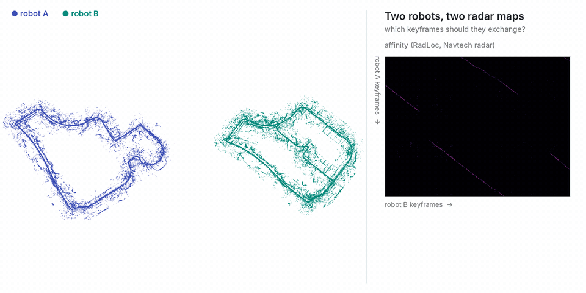

# Spinning radar (Navtech) with RadLoc

<p align="center"></p>

Two robots from MulRan **KAIST_03**: robot A drives the first half (1,172 keyframes, every 2 m), robot B the second half, which re-drives much of A's route. Robot B starts in its own frame: its poses are moved by **yaw 60°, (30, −20, 0) m**. The descriptor is [RadLoc](https://github.com/sparolab/RadLoc) (`thirdparty/RadLoc`, ReFeree++ range bands), compared by its fine distance (mean absolute difference); the affinity is `1 − D / max D`.

```bash
git submodule update --init tools/demo/radar/thirdparty/RadLoc
python tools/demo/radar/make_sessions.py --seq <MulRan>/KAIST_03 --gt <MulRan>/KAIST_03/global_pose.csv --out runs/radar
python tools/demo/radar/points.py --seq <MulRan>/KAIST_03 --sessions runs/radar/robot_a runs/radar/robot_b   # radar points for the GIF
commerge runs/radar/robot_a runs/radar/robot_b --affinity runs/radar/affinity.npy --threshold 0.93 --min-area 50 \
    --registration pairs --policy all --out runs/radar/merged \
    --gt-a runs/radar/robot_a/gt_poses.txt --gt-b runs/radar/robot_b/gt_poses.txt
```

```
[commerge] registered B to A from 14 selected pairs: RMS 1.25 m; vs ground truth: 0.21 m, 0.05 deg (B keyframes 0.45 m off on average)
[commerge] exchanged 12 A + 15 B keyframes (1.2 % of 2344, 2.6 KB of poses) from region(s) [0, 1, 3, 5, 6, 7, 8, 9] of 11
```

The 60° frame is recovered within 0.05°: B's keyframes land 0.45 m from ground truth on average, from 27 of 2,344 keyframes. `--registration pairs` needs no radar scans: the selected pairs are the same places, so B's keyframe positions are fitted onto A's (yaw + translation, outlier pairs dropped). `--policy all` uses the pairs of every region, which spreads them out and pins down the yaw; with one region (default policy) the pairs lie on a short stretch and B's keyframes are 2–11 m off (thresholds 0.91–0.93).
