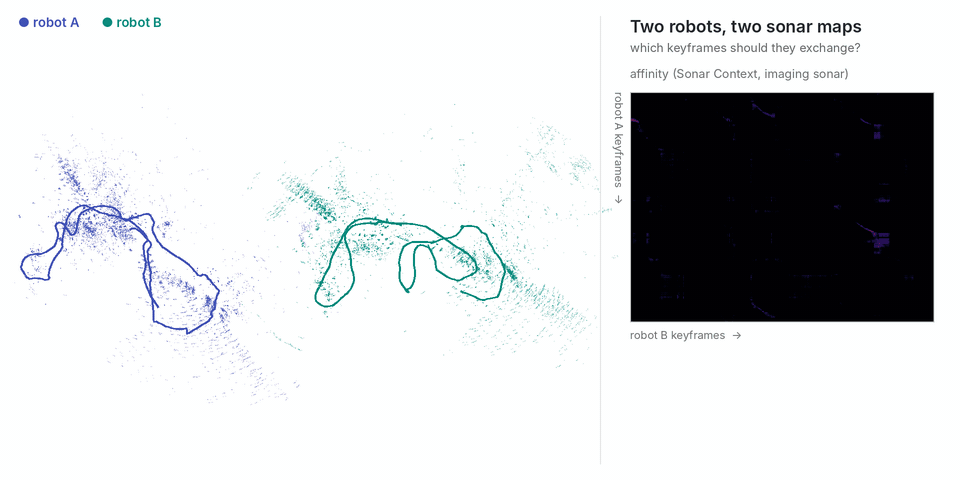

# Imaging sonar with Sonar Context

<p align="center"></p>

Two robots from **Aracati 2017** (an ROV with a BlueView P900-130 forward-looking sonar in a marina): robot A is the first half of the run, robot B the second half (298 keyframes each, every 1 m), moved into its own frame (**yaw 60°, (30, −20, 0) m**). The descriptor is [Sonar Context](https://github.com/sparolab/sonar_context) (`thirdparty/sonar_context`): the max of 4 × 4 patches of the polar image (range × beams), compared by the mean column cosine similarity at the best column (bearing) shift: the library's `sonar_context` and `column_similarity_matrix` (v2, which fixes the original matching's off-by-one shift).

```bash
git submodule update --init tools/demo/sonar/thirdparty/sonar_context
python tools/demo/sonar/make_sessions.py --images <Aracati>/polar_image.zip --gt pose_gt.txt --out runs/sonar
python tools/demo/sonar/points.py --images <Aracati>/polar_image.zip --sessions runs/sonar/robot_a runs/sonar/robot_b
# GIF: python tools/demo/make_gif.py runs/sonar/robot_a runs/sonar/robot_b --affinity runs/sonar/affinity.npy --threshold 0.9 --min-area 50 --registration pairs --range 50 --point-size 1500 --point-alpha 1.6 --point-px 2 --out sonar.gif
commerge runs/sonar/robot_a runs/sonar/robot_b --affinity runs/sonar/affinity.npy --threshold 0.9 --min-area 50 \
    --registration pairs --policy all --out runs/sonar/merged \
    --gt-a runs/sonar/robot_a/gt_poses.txt --gt-b runs/sonar/robot_b/gt_poses.txt
```

```
[commerge] registered B to A from 30 selected pairs: RMS 3.67 m; vs ground truth: 1.98 m, 3.03 deg (B keyframes 1.33 m off on average)
[commerge] exchanged 15 A + 12 B keyframes (4.5 % of 596, 2.6 KB of poses) from region(s) [0, 1, 2] of 3
```

`pose_gt.txt` is the bag's `/pose_gt` topic (DGPS on the surface float) as text: `stamp bagtime x y z qx qy qz qw`. The maps in the GIF are the sonar's own strongest returns (`points.py`: 50 m, 130°). The polar images are stored as (beams, range): `layout="beam_range"` gives Sonar Context its (range, beams), so that its column shift is a rotation; with the image read as stored, revisits and other places score 0.80 vs 0.79 and the merge fails. With a lower threshold (0.88, min area 20) the merge comes to 0.26 m, from 20 % of the keyframes.
