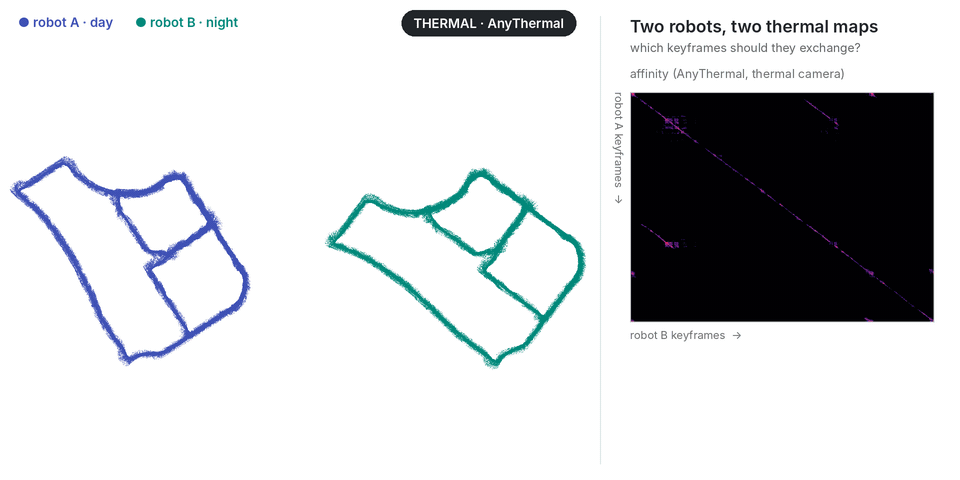

# Thermal camera with AnyThermal

<p align="center"></p>

Two robots on the ViViD++ **campus** route: robot A drives it by day (`campus_day1`, 1,635 keyframes), robot B by night (`campus_night`, 1,645 keyframes), every 2 m of GPS motion. Robot B is moved into its own frame (**yaw 60°, (30, −20, 0) m**). The descriptor is [AnyThermal](https://github.com/castacks/AnyThermal) (ICRA 2026: DINOv2 distilled to thermal, SALAD head; checkpoints on [Hugging Face](https://huggingface.co/theairlabcmu/AnyThermal)), compared by cosine similarity. AnyThermal's backbone was distilled on data that include ViViD++, so this is not a zero-shot result.

```bash
git submodule update --init tools/demo/thermal/thirdparty/AnyThermal tools/demo/thermal/thirdparty/BridgeMultiSpectralDepth
(cd tools/demo/thermal/thirdparty/AnyThermal && git submodule update --init baselines/VPR/salad)
# AnyThermal checkpoints: unzip anythermal_checkpoints.zip into <ckpt>/pretrained_checkpoints
# dependencies beyond Commerge's: torchvision, tyro, natsort, timm, mmcv==1.7.2 (MMCV_WITH_OPS=0), addict, yapf, path
python tools/demo/thermal/extract.py campus_day1.bag runs/thermal/day                     # prints the GPS origin
python tools/demo/thermal/extract.py campus_night.bag runs/thermal/night --origin LAT LON  # the same origin
python tools/demo/thermal/make_sessions.py --day runs/thermal/day --night runs/thermal/night --ckpt <ckpt> --out runs/thermal
python tools/demo/thermal/points.py --ckpt <ckpt> --sessions runs/thermal/day runs/thermal/night \
    --into runs/thermal/robot_a runs/thermal/robot_b                                    # thermal depth, for the GIF
commerge runs/thermal/robot_a runs/thermal/robot_b --affinity runs/thermal/affinity.npy --threshold 0.91 --min-area 300 \
    --registration pairs --policy all --out runs/thermal/merged \
    --gt-a runs/thermal/robot_a/gt_poses.txt --gt-b runs/thermal/robot_b/gt_poses.txt
```

```
[commerge] registered B to A from 35 selected pairs: RMS 3.33 m; vs ground truth: 1.18 m, 0.16 deg (B keyframes 1.09 m off on average)
[commerge] exchanged 34 A + 35 B keyframes (2.1 % of 3280, 6.6 KB of poses)
```

Keyframe poses come from the GPS (`/bestpos`), heading along the track. The maps in the GIF are depth from the thermal image alone: AnyThermal's MiDaS head (`thirdparty/BridgeMultiSpectralDepth`), back-projected with the FLIR A65 13 mm lens (f = 765 px; the bags' `camera_info` is empty), ground removed.
